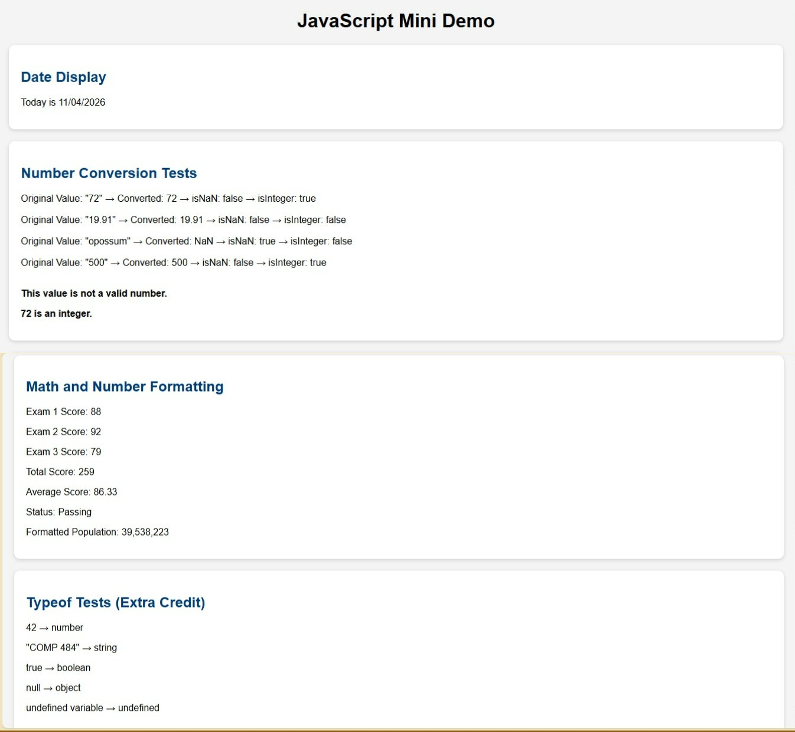

# Homework 9: JavaScript Built-In Objects

Course: COMP 484

---

## Built-In Objects and Methods Used:

### Date Object
- Date()
- getMonth()
- getDate()
- getFullYear()

### Number Object
- Number()
- Number.isNaN()
- Number.isInteger()

### Number Formatting Methods
- toFixed()
- toLocaleString()

### DOM Methods
- document.getElementById()
- innerHTML

### Extra Credit
- typeof

---

## GitHub Pages Link

https://YOUR-USERNAME.github.io/YOUR-REPOSITORY-NAME/

---

## Screenshot

---

## Reflection

The easiest part of this assignment was creating variables and performing arithmetic calculations because the syntax was straightforward and easy to test in the browser. The hardest part was formatting the date correctly and making sure the month and day always displayed as two digits. I learned that the Date object stores date information and requires methods such as getMonth(), getDate(), and getFullYear() to retrieve specific values. I learned that the Number object can convert strings into numeric values and provides helpful validation methods such as Number.isNaN() and Number.isInteger(). I also learned how JavaScript can update webpage content by using DOM methods like document.getElementById() and innerHTML to display results directly in the browser.

---

## Extra Credit Completed

Completed Extra Credit Option #1:

- Added a fourth section that uses the typeof operator to identify the data type of five different values.

Completed Extra Credit Option #4:

- Added CSS styling so each section appears as a separate card or panel.

---

## References

No external sources were used.

This assignment was completed using:
- COMP 484 lecture materials
